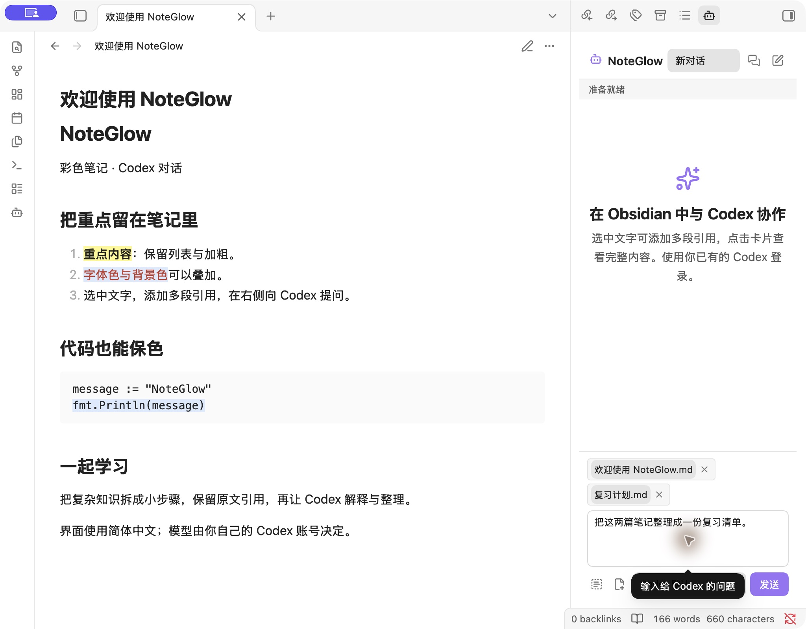
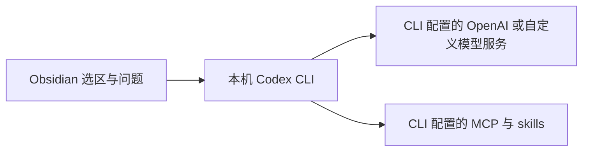

# NoteGlow

在 Obsidian 中用简体中文与本机 Codex CLI 对话，把多段笔记选区作为紧凑引用卡片发送，并将字体色、背景色保存在 Markdown 文件中。

```text
[数据库索引.md:12–15 ×] [练习.md:8 ×]
┌ 输入你的问题……                       ┐
└ [Codex 默认 ▾]          [停止] [发送] ┘
```

**插件按 [MIT 许可证](LICENSE)免费提供。** Codex 账号、订阅、API 用量或其他服务费用由使用者承担；插件不提供免费 AI 额度。这是独立维护的社区项目，与 OpenAI、Obsidian 无官方隶属关系。

维护者：**david yang** · 联系邮箱：[xting.yang@gmail.com](mailto:xting.yang@gmail.com)。



[下载安装包](https://github.com/David2007/noteglow/releases/latest) · [查看演示 Markdown](examples/NoteGlow-demo.md)


## 图片附件

在输入框旁点击“添加图片”，或把截图粘贴到问题框、把图片文件拖到输入区域。支持最多 10 张 PNG、JPEG 或静态 WebP；单张 10 MiB、合计 20 MiB，最大 3200 万像素。点击缩略图可预览，点击 × 从本次问题移除。允许只发图片；新对话与续聊都会通过 CLI 的 `--image` 发送实际图片，不把图片伪装成文字路径。

图片跟随各对话草稿保存，执行失败或停止时保留；历史消息可再次预览。原图私有副本位于 `<Vault>/.obsidian/plugins/codex-notes/image-attachments/`（使用自定义配置目录时跟随该目录），`data.json` 只存随机文件名、尺寸和摘要，不包含 base64 或原始绝对路径。移除草稿卡片不自动删除缓存，避免破坏历史消息；卸载或清理目录前请自行保留需要的原图。Markdown 对话导出仅记录图片名称/尺寸/摘要，不导出原图。

选中并发送的图片会交给本机 CLI 配置的模型服务，适用该账号/服务的数据政策与用量。并非所有模型都支持图片；模型拒绝时会显示错误并保留草稿。不会读取或打包维护者的登录信息。发送使用经摘要复核的临时快照，CLI 完成后清理本轮临时副本。需要支持 `codex exec` 和 `codex exec resume --image` 的 CLI（本机核验版本 0.162.1）。

## 安装

仅支持 Obsidian 桌面端。已实际验证的环境为 macOS、Obsidian **1.14.4**、Codex CLI **0.162.1**；Windows、Linux 和其他 CLI 版本尚未验证。使用前先按 [Codex CLI 官方文档](https://developers.openai.com/codex/cli)安装、登录，并确认终端中的 Codex 可以正常对话。

1. 推荐从本仓库的 **Releases** 页面下载 `NoteGlow-<版本>.zip`，解压后将 `codex-notes` 文件夹放入 `<Vault>/.obsidian/plugins/`。也可下载同一版本的 `main.js`、`manifest.json`、`styles.css`、`LICENSE` 和 `THIRD_PARTY_NOTICES.txt`。若尚无 Release，请使用下文的源码构建方式。
2. 退出 Obsidian，将这五个文件放入 `<Vault>/.obsidian/plugins/codex-notes/`；目录名必须为 `codex-notes`，不要再套一层文件夹。
3. 重新打开 Obsidian，在「设置 → 第三方插件」中手动启用 **NoteGlow**。
4. 在插件设置中核对「Codex CLI 路径」「Vault 权限」和「自动审核批准要求」。自动寻找失败时填写 `codex` 可执行文件的完整路径。

当前新用户默认使用「工作区写入」并开启自动审核，Codex 可以按请求修改 Vault 中的笔记。只需要提问和分析时，可改为「只读」。这些选项交由 CLI 执行，不能绕过 CLI 自身的沙箱、审批或组织策略。

本项目尚未上架 Obsidian 官方社区目录，不应从目录搜索结果推断它已获官方审核。当前代码源自上游 fork，官方目录申请还需满足 [Obsidian 的 fork 上架政策](https://docs.obsidian.md/community-directory/developer-policies)；目前未取得原作者公开可核验的书面许可，也未按失联作者流程申请。

## 引用笔记、提问与选择模型

对话中的用户消息、Codex 回复和错误提示支持直接拖选文字，再按 ⌘C（Windows/Linux 为 Ctrl+C）复制；表格、行内代码和代码块也使用原生文本选择。

在编辑视图选中文字，右键选择「添加选区到 Codex」，或按 **⌘⌥C**（macOS）。命令面板也可以执行「添加选区到 Codex」。可以连续添加同一篇或不同笔记的选区，输入框只写问题。


点击卡片可预览完整路径、行号和原文，点击 **×** 移除。每次最多 30 个引用，原文合计不超过 50,000 字符。可以提问「解释这些索引为什么没有生效」，也可以在工作区写入模式请求「将这些选区整理成复习笔记」。发送前请核对引用内容。

每个对话单独保留草稿、引用和模型选择。模型下拉框读取本机 Codex 的可见模型缓存；选「Codex 默认」时交由 CLI 决定。模型是否可调用取决于当前账号及 CLI 配置。缓存不可用时仍可使用「Codex 默认」，不要把列表缺失理解为账号没有模型权限。

界面使用简体中文，默认请求 Codex 用简体中文回复；代码、路径和引用原文保留原样。发送成功后清空本次草稿，失败或停止后保留。插件不会把本机其他 Codex 客户端的全部会话自动同步进来。

## 字体色、背景色与格式

在编辑视图选中文字，从命令面板执行「字体颜色」「背景颜色」「更换字体颜色」「更换背景颜色」或「清除选区颜色」。字体色和背景色分别记住上次选择，初次默认红字、黄底；快速应用使用已记住的颜色，更换命令打开选区附近的小调色面板：点击预设色立即应用并收起，自定义颜色输入后按 Enter 应用，无需再次确认。按 Esc 或点击面板外取消，不改变记忆；重启后仍保留上次成功应用的颜色。成功应用或清除颜色不弹通知，失败时提醒。

原生代码块可连续选择不同位置，通过上述命令修改或清除颜色；仍使用 Obsidian 原生代码编辑和语法高亮。旧版 HTML 代码块保留兼容工具栏。若需要选区按钮，可以另行安装 **Editing Toolbar**，在其设置中添加 NoteGlow 的命令。对字体色、背景色，分别把「应用」和「更换」命令放在相邻位置。手动安装本插件不会改写其他插件的工具栏或快捷键。

正文中的字体色、背景色、加粗和斜体可以叠加。顶层段落、标题、完整列表和行内代码保留原生 Markdown；颜色范围与原文快照单独保存在块后的注释中，实时预览隐藏记录。点击着色文字可直接编辑，不再展开颜色 HTML。在着色文字上进行格式操作时，请使用 **NoteGlow 的「加粗」「斜体」「行内代码」命令**。如果常用 ⌘B、⌘I、⌘⇧C，请在「设置 → 快捷键」中把对应组合绑定到这些兼容命令，并移除原生同键绑定，避免重复触发。编辑器撤销、重做可用于这些操作；撤销历史是否跨重启保留由 Obsidian 决定。

顶层完整围栏代码块着色后仍保留原始围栏、语言、代码文字和换行；颜色范围与代码快照保存在块后紧邻的 HTML 注释中，编辑与阅读时由插件叠加显示，实时预览隐藏元数据，源代码模式可见。普通输入、删除和缩进会同步移动颜色范围；整行移动或外部编辑造成快照不匹配时暂停颜色显示并保留数据，避免把旧颜色贴到错误文字上。嵌套、缩进或未闭合代码块暂不支持改色。代码块内不支持加粗、斜体等正文格式命令。

原生正文与代码块的自定义颜色需要本版 NoteGlow；其他阅读器或禁用插件后仍能阅读普通 Markdown。旧 HTML 颜色仍能显示，但需先执行恢复命令后再修改。主题会影响未明确指定颜色的文字，不能保证不同阅读器像素一致。

正文跨块选区、引用、表格及包含代码块的列表暂不支持改色。普通输入和删除会同步范围；拆分或合并段落等结构变化会保留旧记录并暂停颜色，避免错位。可执行「重置当前笔记的正文颜色记录」清除当前笔记的正文记录后重新着色；该命令先备份且可撤销，不删除正文或代码块颜色。

公式、双向链接、Obsidian 注释/高亮和 YAML 属性受到保护；选区涉及这些结构时会拒绝改色并提示。未知的原生 HTML 结构不会被自动接管。遇到失败提示时先缩小选区，不要手工删除标签来重试。

## 隐私、网络与本地文件

插件不含遥测，不直接读取或复制 CLI 的认证文件，也不在插件设置中保存 API Key。**这不表示笔记永远留在本机**：点击发送后，问题与引用原文会经本机 CLI 交给其配置的模型服务处理。



| 数据或访问 | 用途与边界 |
| --- | --- |
| Vault 外的模型元数据 | 读取 `$CODEX_HOME/models_cache.json`，未设置时读取 `~/.codex/models_cache.json`，用于模型下拉框。 |
| 本机进程和 CLI 配置 | 启动用户指定的 Codex 可执行文件，以当前 Vault 为工作目录，继承进程环境；CLI 自行读取其登录状态、配置、MCP 和 skills。 |
| 远程服务 | 网络目标取决于 CLI 的 OpenAI 或自定义 provider 以及工具配置；插件没有独立的笔记中转服务器。使用前应核对 CLI 的服务与数据政策。 |
| 插件 `data.json` | 保存在 `<Vault>/.obsidian/plugins/codex-notes/`，包含消息、草稿、选区原文、路径、线程 ID 和设置，可能含敏感笔记。 |
| 颜色与升级备份 | 新颜色保存在 `.md` 正文；`note-colors.json` 保存颜色偏好和未迁移旧记录。升级备份可能包含原笔记、聊天及配置。 |

不要提交或公开分享个人 `data.json`、`note-colors.json`、CLI 登录文件、升级备份或包含私密内容的截图。Vault 同步工具若同步这些文件，也会同步相应原文。报告问题时请删去笔记原文、账号、路径和认证信息。

CLI 兼容性有版本边界：本插件使用 `exec`、JSON 输出、续聊以及自动审核相关参数，包含 `--approve-for-me` 和续聊配置项；这些选项可能在其他版本中不同。若提示未知参数，先核对 CLI 版本和插件版本，不要通过扩大权限解决参数错误。

## 更新与旧颜色迁移

旧版着色 HTML 正文、行内代码和代码块可在当前笔记的编辑视图中执行「NoteGlow：恢复当前笔记的原生正文与代码」。原有「恢复当前笔记的原生代码块」命令仍保留，仅处理代码块。命令先保存并读回原文备份，再一次性转换可无损识别的结构；遇到不支持的结构时停止并保留原文，不会扫描整个 Vault。成功通知给出转换数量和备份路径，编辑器 Undo 可撤销本次转换。备份位于插件目录的 `native-code-backups/`，包含原笔记，请勿公开提交。

普通更新前先退出 Obsidian，并备份插件目录和笔记。只替换同一 Release 的 `main.js`、`manifest.json`、`styles.css`、`LICENSE`、`THIRD_PARTY_NOTICES.txt`，保留 `data.json` 和 `note-colors.json`。本插件不会自动安装或更新自身及依赖。

旧版的颜色范围存放在 `note-colors.json`。有旧记录时，请先备份整个 Vault、退出 Obsidian，再在源码目录预检：

```bash
npm ci --ignore-scripts
npm run migrate:colors -- /完整/Vault/路径
```

核对预检结果后再执行写入：

```bash
npm run migrate:colors -- /完整/Vault/路径 --apply
```

迁移只处理旧记录列出的文件，先备份原文、核验完整正文，再写入和读回；成功后才移除该文件的旧范围。正文冲突会停止操作。若上轮已经写入正文但旧记录提交失败，重跑仅在当前正文精确等于预期结果时完成收尾，不覆盖后续编辑。

备份位于 `<Vault>/.obsidian/codex-notes-backups/portable-colors-<时间戳>/`，请保留其中的报告与原文。回退插件版本不会自动撤销 `.md` 中已迁入的颜色。需要恢复迁移前笔记时，应先保存迁移后的新增编辑，再逐文件核对并恢复备份，避免整库覆盖。

## 从源码构建与定制安装

开发需要 Node.js 22.18 或更新的兼容版本。普通安装只需构建后手动复制五个发布文件：

```bash
npm ci --ignore-scripts
npm run build
```

本地定制脚本适合沿用原有 `codex-workspace` / `codex-selection` 配置的用户，**普通安装不需要运行它**。它会备份并修改插件启用列表、工作区面板路由、Editing Toolbar 配置和格式快捷键，禁用旧插件并启用本插件；已有对话和草稿保留。执行前请退出 Obsidian，核对目标 Vault：

```bash
npm run install:local -- /完整/Vault/路径
# 仅首次导入旧输入框草稿时添加第三个参数：
# npm run install:local -- /完整/Vault/路径 /完整/旧草稿.json
```

可选草稿文件格式为 `{ "text": "旧输入框中的完整文字" }`。定制安装备份位于 `<Vault>/.obsidian/codex-notes-backups/<时间戳>/`。回滚前先备份新插件数据、停止运行中的请求并禁用本插件，再核对恢复相应启用列表、工具栏、快捷键及工作区配置；不要覆盖安装后新增的笔记或对话。

截至 2026-10-17，[远程 CI](https://github.com/David2007/noteglow/actions/runs/39075678535) 的构建与 67 项测试通过；CI 产物已在全新演示 Vault 中安装并完成真实 Codex 对话。覆盖率尚未测量；并发多窗格保存和保存中禁用插件的动态路径仍未实测。后续提交以对应提交的 CI 结果为准。

## 许可证与上游归属

本项目基于 [yamantaka520/Codex-Plugin-for-Obsidian 的 0.3.0 版本](https://github.com/yamantaka520/Codex-Plugin-for-Obsidian/tree/0.3.0)继续开发。原作者为 **yamantaka520**，保留其 MIT 版权声明；本项目的维护者为 **david yang**。再分发时请保留 [LICENSE](LICENSE)、[第三方许可声明](THIRD_PARTY_NOTICES.txt)和上游归属。
